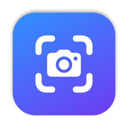

<p align="center">
  
</p>

<h1 align="center">ScreenClip</h1>

<p align="center">
  <b>Mac screenshots, straight to your clipboard — just like on Windows.</b>
</p>

<p align="center">
  <a href="https://github.com/Nolek0/ScreenClip/releases/latest"></a>
  
  
  
</p>

---

ScreenClip is a tiny macOS app that runs quietly in the background. It has no Dock icon and lives only in the menu bar. Every time you take a screenshot, it copies it to your clipboard, so you can paste it anywhere with **⌘V**: Discord, Messages, Slack, Notion, Photoshop…

## ✨ Features

| | Feature | Details |
|---|---|---|
| 📋 | **Auto-copy** | Every screenshot (⌘⇧3, ⌘⇧4, ⌘⇧5) goes straight to the clipboard. |
| 🕘 | **History** | A submenu shows your last 30 screenshots with a large preview. Click one to copy it again. |
| ⚡ | **Thumbnail on/off** | Show or hide the macOS corner thumbnail. Hiding it makes copying instant (it delays saving by about 5 seconds). |
| 🗑️ | **Delete After Copying** | Moves the file to the Trash once copied, so your Desktop stays clean. |
| 🚀 | **Launch at Login** | ScreenClip starts with your Mac. |
| ✅ | **Visual feedback** | The menu bar icon turns into a checkmark for a second when a copy succeeds. |
| ⚙️ | **Settings window** | A clean settings window for every option, one click away in the menu (⌘,). |
| 🔄 | **Built-in updates** | ScreenClip checks GitHub for new versions and updates itself in one click. No reinstalling. |
| 🌍 | **10 languages** | English, Français, Español, Deutsch, Italiano, Português, 简体中文, 日本語, 한국어, Русский. |

## 📦 Install

1. **[Download the latest `ScreenClip-x.y.z.dmg`](https://github.com/Nolek0/ScreenClip/releases/latest)**.
2. Open the DMG and drag **ScreenClip** onto **Applications**.
3. Open ScreenClip from your Applications folder.

### "ScreenClip can't be opened" warning

ScreenClip isn't signed with a paid Apple Developer certificate, so macOS blocks it the first time. To allow it:

- Go to **System Settings › Privacy & Security**, scroll down, and click **Open Anyway** next to the ScreenClip message.

Or run this once in Terminal:

```bash
xattr -dr com.apple.quarantine /Applications/ScreenClip.app
```

### Desktop access

On first launch, macOS asks **"ScreenClip would like to access files in your Desktop folder."** Click **Allow**: that's where macOS saves your screenshots.

> 💡 Then open **Settings…** and turn on **Launch at login** so you never have to think about it again.

### Updating

You only install ScreenClip once. When a new version is out, the menu shows **Update x.y.z Available**. Click it, then **Update Now**: ScreenClip downloads the new version, replaces itself and restarts. You can also use **Check for Updates…** at any time.

## 🖱️ Usage

1. Take a screenshot as usual: **⌘⇧3** (full screen), **⌘⇧4** (selection) or **⌘⇧5** (toolbar).
2. The 📷 icon in the menu bar briefly turns into a ✅.
3. Paste with **⌘V**.

### The menu

Click the 📷 icon in the menu bar:

```
ScreenClip
Folder: Desktop
⬇ Update 1.2.0 Available          (only when there is one)
──────────────────────────────────
🕘 History                       ›
──────────────────────────────────
✓ Copy Automatically
──────────────────────────────────
⚙ Settings…                     ⌘,
↻ Check for Updates…
──────────────────────────────────
Quit ScreenClip                ⌘Q
```

### Settings

Open **Settings…** from the menu (or open ScreenClip again from your Applications folder).

| Tab | Options |
|---|---|
| **General** | Language · Copy screenshots automatically · Show screenshot thumbnail · Delete file after copying · Screenshot folder · Launch at login |
| **History** | Click to copy (off: opens in Preview) · Screenshots shown in the menu (10–50) · Saved screenshot count · Skip Trash when clearing · Clear History |
| **Updates** | Current version · Check Now · What's new · Update Now · Check automatically at launch |
| **About** | Version, link to GitHub |

**Show screenshot thumbnail:** on, macOS shows the corner preview but the copy waits ~5 s. Off, no preview and the copy is instant.

**Language:** follows your Mac by default. Pick any of the 10 languages to switch instantly.

### History

- The **30 most recent** screenshots appear in the menu, newest first (change it in Settings › History).
- ScreenClip keeps its own copy of the **last 200** screenshots in
  `~/Library/Application Support/ScreenClip/History`.
- At the top of the submenu, the red **Clear History** button empties the history. By default the files go to the Trash.
- Tick **Skip Trash (Delete Permanently)** right below it to delete them for good instead. ScreenClip asks for confirmation first, since this can't be undone.
- At the bottom of the submenu: **Open History Folder**.

## ⚙️ How it works

1. ScreenClip reads the folder where macOS saves screenshots (the Desktop by default, or whatever you picked in ⌘⇧5 › Options). If you change it, ScreenClip picks it up within about 10 seconds.
2. It watches that folder. When a new file appears, it checks for the tag macOS puts on every screenshot (`kMDItemIsScreenCapture`). Other files you add to the Desktop are ignored.
3. The image goes to the clipboard, and a copy is saved to the history.

**Why is there sometimes a delay?** By default, macOS shows a thumbnail in the bottom-right corner for about 5 seconds and only saves the file afterwards. Turn off **Show screenshot thumbnail** in Settings to remove it. It's the same as unticking "Show Floating Thumbnail" in ⌘⇧5 › Options.

## 🛠️ Build from source

You need the Xcode command line tools:

```bash
xcode-select --install
```

Then:

```bash
git clone https://github.com/Nolek0/ScreenClip.git && cd ScreenClip
```

```bash
./build.sh          # builds ScreenClip.app (universal: Apple Silicon + Intel)
```

```bash
./build.sh --dmg    # also builds ScreenClip-<version>.dmg
```

```
ScreenClip/
├── main.swift              # App, menu bar, folder watching, clipboard
├── History.swift           # History storage, thumbnails, preview menu rows
├── Settings.swift          # Settings window (SwiftUI)
├── Updater.swift           # GitHub Releases update check and self-install
├── Localization.swift      # The 10 languages
├── scripts/make_icon.swift # Draws the app icon
└── build.sh                # Builds the .app (ad-hoc signed) and the DMG
```

- No Xcode project and no dependencies: just `swiftc`, AppKit and ServiceManagement.
- `LSUIElement = true` in `Info.plist` is what hides the Dock icon.
- The version number is set at the top of `build.sh`.

> ⚠️ The app is ad-hoc signed, so macOS may ask for Desktop access again after each rebuild. Just click **Allow**.

## 🧹 Uninstall

1. In **Settings › General**, turn off **Launch at login**, then choose **Quit ScreenClip** in the menu.
2. Delete the app and its history:

```bash
rm -rf /Applications/ScreenClip.app ~/Library/Application\ Support/ScreenClip
```

3. If you turned the thumbnail off and want it back:

```bash
defaults write com.apple.screencapture show-thumbnail -bool true
```

## 📄 License

[MIT](LICENSE)
